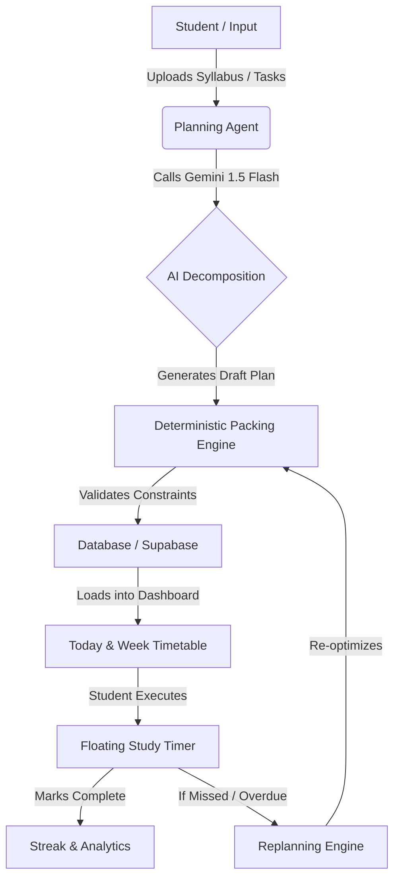

# 🧠 HELIX — Adaptive AI Student Planner

> **An intelligent student planning and study platform that adapts to your real academic workload, availability, deadlines, priorities, and learning progress.**

[](https://www.typescriptlang.org/)
[](https://react.dev/)
[](https://vitejs.dev/)
[](https://tailwindcss.com/)
[](https://supabase.com/)
[](https://firebase.google.com/)
[](https://ai.google.dev/)
[](https://helix-kappa-liart.vercel.app/)
[](https://ollama.com/)
[](https://groq.com/)
[](https://opensource.org/licenses/MIT)

## 🌐 Live Demo

**👉 [https://helix-kappa-liart.vercel.app/](https://helix-kappa-liart.vercel.app/)**

---

# 🎯 Why HELIX Exists

Students rarely have only one responsibility. A typical student simultaneously juggles:
- Multiple subjects with dense, evolving syllabi
- Continuous homework, assignments, and lab records
- Mid-semester and final exams
- Multi-phase group and individual projects
- Weekly quizzes and flashcard drills
- Strict deadlines with varying penalties
- Fluctuating daily energy levels and peak focus windows
- Unexpected disruptions (illness, surprise tests, schedule changes)

The problem is not simply:
> *"I have too many tasks."*

The deeper problem is:
> **"I don't know what I should do, when I should do it, how much time I actually have, and what should change when something unexpected happens."**

Traditional productivity applications treat tasks as disconnected, static checklist items. **HELIX treats the student's academic life as a dynamic, interconnected system.**

---

# ❗ Problem Statement

Students are constantly forced to solve an NP-hard scheduling problem in their heads:

$$\text{Optimal Plan} = f(\text{Workload}, \text{Deadlines}, \text{Effort}, \text{Available Time}, \text{Energy Curves}, \text{Subject Importance}, \text{Disruptions})$$

Without intelligent algorithmic guidance, students experience:
1. **The Planning Fallacy**: Underestimating how long deep-work tasks take.
2. **Deadline Crashing**: Cramming 20 hours of work into the final 24 hours before submission.
3. **Cognitive Fatigue**: Spending hours deciding *what* to study instead of actually studying.
4. **Plan Fragility**: A single missed day causes an entire rigid schedule to collapse, leading to abandonment of the planner.

---

# 🚫 The Problem With Existing Student Planners

| Traditional Planners | Why They Fail for Students |
| :--- | :--- |
| **Standard To-Do Lists** *(Todoist, Things, Apple Reminders)* | Lack awareness of time slots, academic syllabus structure, or study capacity. |
| **Calendar Blockers** *(Google Calendar, Notion)* | Rigid and manual. When a 2-hour block is missed, the calendar does not adjust itself. |
| **Pure AI Chatbots** *(ChatGPT, Copilot)* | Hallucinate impossible schedules, ignore realistic 24-hour time budgets, and have no persistent database tracking. |
| **Generic Habit Trackers** | Focus on streaks rather than deadline-driven academic output. |

---

# 💡 HELIX Solution

HELIX bridges the gap between **Generative AI creativity** and **Deterministic mathematical rigor**:

```
 ┌────────────────────────────────────────────────────────┐
 │                      STUDENT INPUT                     │
 │  Syllabus PDF • Tasks • Deadlines • Daily Availability │
 └───────────────────────────┬────────────────────────────┘
                              │
                              ▼
 ┌────────────────────────────────────────────────────────┐
 │                    AI PROPOSAL LAYER                   │
 │   Breaks syllabi into units, generates milestones,     │
 │       estimates effort & drafts study sessions         │
 └───────────────────────────┬────────────────────────────┘
                              │
                              ▼
 ┌────────────────────────────────────────────────────────┐
 │             DETERMINISTIC VALIDATION ENGINE            │
 │   Enforces 24h budget limits, zero slot overlaps,      │
 │    respects energy peaks, & detects deadline conflicts │
 └───────────────────────────┬────────────────────────────┘
                              │
                              ▼
 ┌────────────────────────────────────────────────────────┐
 │              ADAPTIVE STUDENT DASHBOARD                │
 │    Interactive Timetable • Study Hub • Replanning      │
 │     Floating PIP Timer • Web Push Notifications        │
 └────────────────────────────────────────────────────────┘
```

---

# 🧭 Core Philosophy

> ### **"AI proposes. Deterministic logic validates. The student decides."**

1. **AI Proposes**: Large Language Models (Google Gemini & Groq Llama) parse complex PDFs, extract subjects, break projects into granular subtasks, formulate interactive quizzes, and recommend study paths.
2. **Deterministic Logic Validates**: Mathematical algorithms enforce hard constraints—no two tasks can occupy the same minute, no day can exceed 24 hours, and study blocks align with designated energy peaks.
3. **The Student Decides**: The student retains complete agency. Every AI proposal or replan suggestion requires explicit student acceptance or manual refinement.

---

# ⚡ Key Features

- 📅 **Dynamic Today & Week Timetable**: Real-time interactive schedule with live progress tracking.
- 🤖 **Conversational Planning Agent**: Natural language assistant that converts syllabi and assignments into structured actionable plans.
- 🔄 **Intelligent Conflict Replanning**: 1-click schedule repair when tasks are missed or urgent events arise.
- 📚 **Integrated Study Hub**: Complete syllabus unit breakdown, AI flashcard sparks, and topic learning summaries.
- 🎯 **Curated Lecture Recommendations**: Automated YouTube educational lecture search filtered strictly by topic name.
- ⏱️ **Picture-in-Picture Floating Study Timer & Stopwatch**: Draggable floating window with ambient noise generator, lap tracking, custom minute inputs, and melodic Web Audio API alarm chime.
- 📊 **Academic Analytics**: Subject completion distribution donut charts, focus hours tracking, and productivity velocity metrics.
- 👁️ **Triple Appearance Engine**: Clean Light mode, Sleek Dark mode, and true 2700K optical **Eye Comfort Warm Shield** for late-night study sessions.
- 🔔 **Firebase Cloud Messaging Web Push**: Real browser push notifications for scheduled session reminders and deadline alerts.
- ⌨️ **Command Palette (`⌘K` / `Ctrl+K`)**: Instant keyboard-first navigation and rapid action execution.
- 🔥 **Dynamic Gamification Streak**: Calculated from verified task completion timestamps without fake or synthetic counters.

---

# 🔍 Complete Feature Breakdown

### 1. Dashboard (`/dashboard`)
- **Daily Focus Metric Bar**: Displays today's planned hours, completed tasks, weekly study velocity, and live study streak.
- **Priority Queue**: Highlights high-impact tasks scheduled for the current day.
- **Subject Mastery Overview**: Visual progress bars showing syllabus completion percentage per enrolled subject.
- **Active Projects Tracker**: Live milestone burn-down progress for multi-stage assignments.

### 2. Today View (`/today`)
- **Chronological Time-Slot Grid**: Displays scheduled study blocks aligned with personal energy peaks (Morning, Afternoon, Evening, Night).
- **1-Click Completion & Time Logging**: Instantly marks tasks complete, records actual duration, and triggers celebration confetti bursts.
- **Emergency Task Insertion**: Quick-action modal to inject urgent unexpected assignments into the day's schedule.

### 3. Week View (`/week`)
- **Multi-View Timetable**: Switch between full 7-Day Matrix and Condensed Workload Views.
- **Workload Heatmap**: Visual indicators warning against overloaded study days.
- **Day-by-Day Hour Allocation**: Displays exact daily study hour limits against configured availability.

### 4. Planning Agent (`/planning-agent`)
- **Syllabus PDF & Text Parser**: Upload official course syllabus documents for automatic parsing into subjects, modules, topics, and subtopics.
- **Conversational Plan Generator**: Ask the agent to plan an exam prep schedule or assignment roadmap.
- **Structured Plan Preview**: Interactive staging area to review, edit, and approve generated tasks before committing them to the database.

### 5. Study Hub & AI Learning (`/study-hub`, `/topic/:id`)
- **Subject Syllabus Navigator**: Hierarchy view of units, topics, and learning statuses (Not Started, In Progress, Mastered).
- **AI Deep-Dive Explanations**: Instant topic summaries, key concepts, formulas, and real-world examples.
- **Curated Educational Videos**: Embedded YouTube tutorial lectures matched directly to the active topic.
- **Interactive MCQ Practice & Quizzes**: Custom multiple-choice questions with instant scoring, feedback, and explanation for incorrect choices.

### 6. Projects & Milestones (`/projects/:id`)
- **Milestone Breakdown**: Automatically decomposes large semester projects into logical stages (Research, Draft, Code, Test, Submit).
- **Deadline Proximity Guard**: Visual warnings when a milestone is at risk of breaching the final submission date.
- **Progress Burn-Down**: Live tracking of completed vs. remaining project deliverables.

### 7. Replanning Engine (`/replanning`)
- **Health Audit**: Continuously checks for overdue items, scheduling conflicts, and overloaded days.
- **Proposal Generation**: Calculates optimal reallocation of deferred tasks without disrupting existing commitments.
- **Differential View**: Side-by-side comparison of "Current Plan" vs. "Proposed Plan" with 1-click apply.

### 8. Floating Study Timer & Stopwatch (Universal Component)
- **Picture-in-Picture Window**: Draggable anywhere across the screen, persistable across page transitions.
- **Mini Shrunk Bar**: Compact floating pill mode (`⏱ 24:12 [▶] [⤢] [✕]`).
- **Custom Timer Presets**: 15m, 25m (Pomodoro), 45m, 60m, 90m, and custom minute duration inputs.
- **Full Stopwatch Mode**: Count-up timer with split/lap logging and direct "Log to Weekly Hours" export.
- **Audio Chime & Confetti**: Melodic Web Audio API dual-oscillator bell chime on completion.

### 9. Browser Push Notifications (FCM V1)
- **Real Web Push**: Direct browser delivery via Firebase Cloud Messaging Service Worker.
- **Permission Flow**: Explicit user-action trigger ("Enable Browser Notifications" in Settings).
- **Background Notification Action**: Clicking notifications refocuses HELIX directly to `/today`.
- **Authenticated Test Dispatch**: Backend verification endpoint (`POST /api/notifications/test-push`).

---

# ⚙️ How HELIX Works

```
Step 1: Onboarding & Profile Setup
   │─── Student sets Course, Stream, Year, and Enrolled Subjects.
   └─── Student defines 24h Availability Slots (Mon–Sun) & Energy Peaks.

Step 2: Workload Ingestion
   │─── Upload Syllabus PDF or enter Tasks / Projects with deadlines.
   └─── AI structures items into units with estimated effort hours.

Step 3: Deterministic Plan Synthesis
   │─── Planner packs tasks into available time slots.
   └─── Aligns high-difficulty tasks with high-energy windows.

Step 4: Execution & Feedback Loop
   │─── Student marks tasks complete via Today View or Study Timer.
   │─── Actual study time updates velocity metrics and streak.
   └─── If tasks are skipped, Replanning Engine proposes an optimized repair.
```

---

# 🧮 Adaptive Planning Engine

The deterministic packing algorithm operates on mathematical scheduling principles:

1. **Time-Budget Invariant**:
   $$\sum_{i \in \text{DayTasks}} \text{Duration}(i) \le \text{AvailableStudyHours}(\text{Day})$$
2. **Deadline Constraint**:
   $$\text{ScheduledDate}(i) \le \text{DueDate}(i)$$
3. **Energy Matching Heuristic**:
   $$\text{DifficultyScore}(i) \times \text{EnergyMultiplier}(\text{TimeSlot}) \to \text{Maximized Focus}$$
4. **Buffer Maintenance**: Guarantees a minimum 10-15 minute rest buffer between high-intensity study blocks.

---

# 🤖 AI Layer & Open-Weight Provider Architecture

HELIX features a unified, server-side AI provider abstraction with configurable backends:

```bash
AI_PROVIDER=gemini | groq | ollama
```

All model requests are managed exclusively through the Express backend gateway (`server/ai/`), preventing API key leakage to browser bundles and ensuring strict output validation.

### Supported Providers & Models:

| Provider | Runtime Type | Default Model | Primary Responsibilities | Privacy & Cost |
| :--- | :--- | :--- | :--- | :--- |
| **Ollama** | **Local Inference (Windows)** | [`qwen2.5-coder:3b`](https://huggingface.co/Qwen/Qwen2.5-Coder-3B) | Topic study guides, syllabus extraction, MCQs, replanning logic | **100% On-Device, Zero API Fees, Total Privacy** |
| **Groq** | **Hosted LPU Cloud** | `openai/gpt-oss-120b` | High-speed open-weight cloud inference | Ultra-low latency, hosted rate limits |
| **Google Gemini** | **Frontier Cloud API** | `gemini-1.5-flash` | Large syllabus PDF comprehension & multi-modal materials | Cloud inference, requires API key |

---

### 🌟 Open-Weight Model Showcase: Qwen 2.5 Coder 3B

HELIX natively uses the open-weight model **Qwen 2.5 Coder 3B** (`qwen2.5-coder:3b`) running on a local Ollama daemon.

- **Upstream Model Card**: [https://huggingface.co/Qwen/Qwen2.5-Coder-3B](https://huggingface.co/Qwen/Qwen2.5-Coder-3B)
- **Model License**: [Apache 2.0 Permissive License](https://huggingface.co/Qwen/Qwen2.5-Coder-3B/blob/main/LICENSE)
- **Parameter Size**: 3.1 Billion parameters (Q4_K_M 4-bit quantization, ~1.9 GB download)
- **Architecture**: Dense Transformer with Grouped Query Attention (GQA), RoPE, 32k context length.

#### **Real Application Workflows Powered by the Open-Weight Model:**
1. **Syllabus PDF / Text Ingestion (`POST /api/ai/extract-syllabus`)**: Parses unstructured university curricula into structured subjects, units, topics, and study durations.
2. **Topic Study Guides (`POST /api/ai/topic-content`)**: Formulates intuitive metaphors, in-depth theoretical breakdowns, worked examples, and semester exam tips.
3. **Interactive Quizzes (`POST /api/ai/generate-quiz`)**: Formulates 4 realistic multiple-choice questions with answer keys and conceptual rationales.
4. **Adaptive Replanning Explanation (`POST /api/planner/replan`)**: Formulates student-friendly explanations of why specific focus blocks were rebalanced when an urgent assignment was added.

---

### ⚖️ Local Inference vs. Hosted Inference

| Dimension | Local Inference (Ollama) | Hosted Cloud Inference (Groq / Gemini) |
| :--- | :--- | :--- |
| **Data Privacy** | **Complete.** Zero student notes, syllabi, or schedules leave the local device. | Prompts are transmitted over HTTPS to cloud servers. |
| **API Costs & Rate Limits** | **$0.00 forever.** No quota exhaustion or rate limits. | Bound by cloud subscription tiers and per-minute quotas. |
| **Offline Capability** | Operates with zero internet connectivity. | Requires reliable high-speed internet. |
| **Hardware Dependency** | Bound by local CPU/GPU/RAM. Cold-start load time ~10–25s. | Serverless cluster execution with instant warm response. |

---

### 💻 Hardware & Performance Considerations

- **Minimum Hardware Requirements**:
  - RAM: 8 GB system RAM (minimum 3 GB free for model weights).
  - Storage: ~2.5 GB free disk space for the GGUF weights.
  - OS: Windows 10/11 64-bit, macOS (Apple Silicon recommended), or Linux.
- **Hardware Acceleration**:
  - When an NVIDIA GPU with CUDA or Apple Silicon is detected, Ollama automatically offloads layers to VRAM for sub-second token generation.
  - On CPU-only laptops, expect 15–35 tokens/second, which comfortably generates complete study guides in 5–12 seconds.
- **Cold-Start Latency**:
  - The first request after starting Ollama requires loading weights into RAM (~10-20s). Subsequent requests execute against warm memory in under 5 seconds.

---

### 🛡️ Safety & Architectural Invariants

> **"AI proposes. Deterministic logic validates. The student decides."**

HELIX enforces strict separation of concerns between generative AI and mathematical scheduling:
1. **No Competing Schedulers**: The model is **never** the authority for:
   - Available study hours calculation
   - Time-slot overlap or collision detection
   - Hard deadline enforcement
   - Task completion history or streak counting
2. **Deterministic Scheduler**: All calendar math is evaluated by `DeterministicPlanner` using mathematical ratios and capacity invariants.
3. **Strict Schema Validation**: Model JSON outputs are stripped of markdown wrappers, extracted, and verified against TypeScript schemas (`server/ai/validator.ts`). If a model produces malformed JSON, a graceful fallback is provided with explicit `isFallback: true` labeling—failures never masquerade as successful AI generations.

---

# 📱 Notifications

- **In-App Alerts**: Floating notification center inside the top bar for active study sessions, replan suggestions, and streak milestones.
- **Web Push Notifications**: Standardized Web Push API powered by Firebase Cloud Messaging.
- **Service Worker (`public/firebase-messaging-sw.js`)**: Background message handler ensuring alerts arrive even when the HELIX tab is closed or minimized.
- **Device Management**: Device registration tokens are associated with authenticated user IDs in the Supabase `notification_devices` table.

---

# 🗄️ User Data Model

```typescript
interface UserProfile {
  id: string;
  name: string;
  email: string;
  course: string;
  stream: string;
  year: string;
  enrolledSubjects: string[];
  theme: 'light' | 'dark' | 'eye-comfort';
  eyeComfortWarmth: number;
  reminderTimings: string[];
  notificationPreferences: {
    inApp: boolean;
    fcmPush: boolean;
  };
}
```

---

# 🏗️ Architecture

```text
┌─────────────────────────────────────────────────────────────────┐
│                           CLIENT BROWSER                          │
│ React 19 • TypeScript • Tailwind CSS 4 • Lucide Icons • Confetti │
└───────────────────────────────────────┬─────────────────────────────┘
                                        │ HTTP / REST / Realtime
                    ┌───────────────────┴───────────────────┐
                    │                                       │
                    ▼                                       ▼
┌───────────────────────────────────────┐   ┌──────────────────────────────┐
│            EXPRESS BACKEND            │   │      SUPABASE CLOUD          │
│ • Deterministic Packing Engine        │   │ • PostgreSQL Database        │
│ • Google Gemini 1.5 Flash API         │   │ • Row Level Security (RLS)   │
│ • Groq AI Fallback Engine             │   │ • User Authentication        │
│ • YouTube Search API Integration      │   │ • Realtime Subscriptions     │
│ • Firebase Admin FCM Push Sender      │   │ • Offline LocalStorage Sync  │
└───────────────────────────────────────┘   └──────────────────────────────┘
```

---

# 💻 Technology Stack

### Frontend:
- **Framework**: React 19 with TypeScript
- **Build Tool**: Vite 6
- **Styling**: Tailwind CSS 4 & Custom Optical Glassmorphism Tokens
- **Icons**: Lucide React
- **Animations & Effects**: Canvas Confetti, CSS 3D Glow Transforms
- **Push Client**: Firebase Web SDK 10 (Modular Messaging API)

### Backend:
- **Runtime**: Node.js & Express
- **TypeScript Runner**: `tsx`
- **AI Integrations**: `@google/generative-ai` (Gemini), Groq SDK
- **Push Server**: `firebase-admin`
- **Security**: CORS, Dotenv, Input Sanitation

### Database & Storage:
- **Database**: Supabase PostgreSQL 15
- **Security Layer**: PostgreSQL Row-Level Security (RLS)
- **Authentication**: Supabase Auth (JWT)

---

# 📄 Application Pages

| Route | Page | Description |
| :--- | :--- | :--- |
| `/` | `LandingPage.tsx` | Overview, feature highlights, student value proposition. |
| `/login` | `LoginPage.tsx` | Supabase authentication (Email & Password login/signup). |
| `/onboarding` | `OnboardingPage.tsx` | 3-step setup (Academic Profile, Availability, Preferences). |
| `/dashboard` | `DashboardPage.tsx` | Live command center with focus metrics, priority queue, and streaks. |
| `/today` | `TodayPage.tsx` | Chronological schedule grid with 1-click completion. |
| `/week` | `WeekPage.tsx` | 7-day timetable matrix and workload distribution planner. |
| `/planning-agent` | `PlanningAgentPage.tsx` | AI syllabus parser, prompt assistant, and draft plan staging area. |
| `/study-hub` | `StudyHubPage.tsx` | Subject syllabus progress, flashcards, and topic navigator. |
| `/topic/:id` | `TopicLearningPage.tsx` | Deep topic breakdown, curated YouTube lectures, and MCQ quizzes. |
| `/quiz` | `QuizPage.tsx` | Interactive quiz interface with timer and option selection. |
| `/quiz-result` | `QuizResultPage.tsx` | Quiz scorecard with breakdown of correct/incorrect answers. |
| `/project/:id` | `ProjectDetailPage.tsx` | Multi-milestone project roadmap with deadline tracking. |
| `/replanning` | `ReplanningPage.tsx` | Automated schedule conflict analysis and resolution proposal. |
| `/analytics` | `AnalyticsPage.tsx` | Study hour breakdown, subject balance, and productivity velocity. |
| `/settings` | `SettingsPage.tsx` | Profile details, 24h day-wise slots, Browser Push control, Theme picker. |

---

# 🔐 Security

- **Strict Environment Separation**: Private keys and service role tokens are strictly confined to the backend server and never leaked into client bundles.
- **Row Level Security (RLS)**: Enforced across all database tables (`auth.uid() = user_id`).
- **No Secret Leaks**: Verified zero secret keys committed in source control.
- **Logout Cleanup**: Disassociates device push tokens on student logout to prevent cross-account notification bleed.

---

# 🔑 Environment Variables

### Frontend Configuration (`.env.local`):
```env
VITE_SUPABASE_URL=https://your-project.supabase.co
VITE_SUPABASE_PUBLISHABLE_KEY=your_supabase_publishable_key
VITE_API_BASE_URL=http://localhost:5000
```

### Backend Configuration (`server/.env`):
```env
PORT=5000
SUPABASE_URL=https://your-project.supabase.co
SUPABASE_PUBLISHABLE_KEY=your_supabase_publishable_key
SUPABASE_SECRET_KEY=your_supabase_secret_key
# Unified AI Provider Selection: ollama | groq | gemini
AI_PROVIDER=ollama
AI_TIMEOUT_MS=45000

# 1. Local Open-Weight Inference (Ollama on Windows)
OLLAMA_BASE_URL=http://localhost:11434
OLLAMA_MODEL=qwen2.5-coder:3b

# 2. Cloud Open-Weight Inference (Groq)
GROQ_API_KEY=your_groq_api_key
GROQ_MODEL=openai/gpt-oss-120b

# 3. Frontier Cloud Multimodal (Google Gemini)
GEMINI_API_KEY=your_gemini_api_key
GEMINI_MODEL=gemini-1.5-flash

# YouTube Data API
YOUTUBE_API_KEY=your_youtube_api_key
```

---

# 🚀 Local Development & Ollama Setup Guide

Follow these steps to run HELIX with the open-weight model `qwen2.5-coder:3b` on Windows, macOS, or Linux.

### 1. Install & Launch Ollama on Windows

1. Download the Windows installer from [https://ollama.com/download/windows](https://ollama.com/download/windows).
2. Run the installer (`OllamaSetup.exe`). Once installed, Ollama runs in the background and mounts its HTTP daemon at `http://localhost:11434`.
3. Open PowerShell or Command Prompt and download the open-weight model:
   ```powershell
   ollama run qwen2.5-coder:3b
   ```
4. Verify that the model is loaded and available:
   ```powershell
   ollama list
   # Output should display:
   # NAME                ID              SIZE      MODIFIED
   # qwen2.5-coder:3b    f72c60cabf62    1.9 GB    ...
   ```
5. You can test the HTTP daemon response directly:
   ```powershell
   curl.exe http://localhost:11434/api/tags
   ```

### 2. Clone the Repository & Install Dependencies

```bash
git clone https://github.com/GovindaSaiKiran/helix.git
cd helix
pnpm install # or npm install
```

### 3. Configure Environment Variables

```bash
# 1. Copy backend environment
cp server/.env.example server/.env

# Ensure AI_PROVIDER is set to ollama:
# AI_PROVIDER=ollama
# OLLAMA_BASE_URL=http://localhost:11434
# OLLAMA_MODEL=qwen2.5-coder:3b

# 2. Copy frontend environment
cp .env.example .env.local
```

### 4. Run Automated Verification Tests

```bash
pnpm test # or npm test
```
Runs the 17-test suite verifying:
- Centralized provider selection (`gemini`, `groq`, `ollama`)
- Missing key enforcement without secret leakage
- Non-streaming Ollama chat protocol parsing and error handling
- Ollama timeout and network failure resilience
- Strict schema validation for syllabi, topics, and quizzes
- Deterministic capacity balancing and replanning integrity

### 5. Start HELIX Development Servers

Open two terminal windows:

```bash
# Terminal 1: Express Backend Gateway (Port 5000)
npm run server

# Terminal 2: React 19 Frontend (Vite on Port 5173)
npm run dev
```

Visit **`http://localhost:5173`** in your browser.

---

# 🧪 Demonstrating the Open-Weight Model in HELIX

To experience and verify the open-weight model in action:

1. **AI Diagnostic & Latency Probe**:
   - Navigate to **Settings** (`/settings`) from the sidebar.
   - Click the **AI & Models** tab.
   - Observe the **Ollama (Local)** active badge showing `qwen2.5-coder:3b`.
   - Click **"Probe Active"** or **"Test Ollama"**. The backend issues a live request to `http://localhost:11434/api/chat` and reports round-trip latency, connection status, and sample JSON output.

2. **Live Topic Study Guide Generation**:
   - In the **AI & Models** tab, click **"Run Topic Workflow"**.
   - The local `qwen2.5-coder:3b` model receives the academic prompt, formulates an everyday analogy, decomposes core principles, and produces semester exam tips.
   - Notice the source tag: `Source: ollama (qwen2.5-coder:3b) [Live Inference]`.

3. **Autonomous Curriculum Ingestion & Quizzes**:
   - Go to **Study Hub** (`/study`).
   - Open any topic or syllabus unit to automatically generate structured topic guides or 4-option MCQs.
   - All prompts are processed locally through the Express gateway with zero cloud tokens consumed.

4. **Adaptive Replanning with Deterministic Guarantees**:
   - Go to **Replanning View** (`/replan`).
   - Click **"⚡ Simulate Urgent Task"**.
   - The deterministic scheduler recalibrates the timetable without exceeding daily available hours, while the open-weight model generates the contextual explanation (`AI Rebalancing Logic`).

---

# 📦 Production Deployment

### Frontend (Vercel):
1. Connect your GitHub repository to Vercel.
2. Set build command to `npm run build` and output directory to `dist`.
3. Add `VITE_*` environment variables in the Vercel project settings.

### Backend (Render / Railway / Fly.io / Self-Hosted VPS):
1. Deploy the `server/` directory as a Node.js service.
2. Set start command to `npm run server`.
3. Populate `server/.env` secrets (e.g., set `AI_PROVIDER=groq` or `AI_PROVIDER=gemini` for cloud hosting, or point `OLLAMA_BASE_URL` to a self-hosted GPU endpoint).

---

# 📁 Project Structure

```text
helix/
├── public/
│   ├── favicon.svg
│   └── firebase-messaging-sw.js
├── server/
│   ├── .env.example
│   ├── index.ts
│   └── planner/
│       └── deterministicPlanner.ts
├── src/
│   ├── components/
│   ├── context/
│   ├── data/
│   ├── lib/
│   ├── pages/
│   ├── services/
│   ├── types/
│   ├── utils/
│   ├── App.tsx
│   ├── index.css
│   └── main.tsx
├── .env.example
├── .gitignore
├── package.json
├── tsconfig.json
└── vite.config.ts
```

---

# 🔄 Data Flow



---

# ⚖️ AI vs Deterministic Logic

| Responsibility | AI Layer | Deterministic Logic |
| :--- | :---: | :---: |
| Extract topics from dense syllabus PDFs | ✅ | ❌ |
| Ensure no tasks overlap in time | ❌ | ✅ |
| Generate interactive MCQ questions with feedback | ✅ | ❌ |
| Enforce 24-hour day availability cap | ❌ | ✅ |
| Generate intuitive task descriptions & tips | ✅ | ❌ |
| Calculate consecutive daily streak accurately | ❌ | ✅ |
| Propose recovery plan for missed deadlines | ✅ | ❌ |
| Validate milestone sequence preceding project deadline | ❌ | ✅ |

---

# 🛡️ Failure Handling & Graceful Degradation

1. **AI API Outage or Rate Limit**: Automatically switches to the secondary Groq LLM or falls back to template-based deterministic task generation.
2. **Offline & Guest Mode**: Automatically uses browser `localStorage` to cache student profiles, tasks, and availability when offline or in guest evaluation mode.
3. **Push Notification Blocked**: Gracefully displays in-app toast alerts inside the application top bar if browser push permission is denied or unsupported.

---

# 🧪 Testing & Verification

- **Type Safety**: Built with strict TypeScript validation (`tsc -b`).
- **Production Build Verification**: All builds pass with zero compilation errors (`npm run build`).
- **Secret Audit**: Grep automated verification ensuring 0 credentials or private keys are tracked in git history.

---

# 🔮 Future Improvements

- [ ] Native Mobile App wrapper (React Native / Capacitor) with OS lock-screen widgets.
- [ ] Direct Google Classroom & Canvas LMS assignment synchronization.
- [ ] Audio flashcard playback using Web Speech Synthesis API.
- [ ] Collaborative study rooms with synchronized Pomodoro timers.

---

# 🏆 Project Goals

HELIX was built to provide students with a comprehensive, stress-free academic productivity environment that protects focus, guarantees realistic deadlines, and adapts in real time to the chaotic nature of student life.

---

# 📜 License & Acknowledgments

HELIX is open-source software licensed under the **[MIT License](LICENSE)**.

### Model Weights & Third-Party Terms:
- **Qwen 2.5 Coder 3B**: Open weights licensed under [Apache 2.0](https://huggingface.co/Qwen/Qwen2.5-Coder-3B) by Alibaba Cloud / Qwen Team.
- **Groq LPU**: Governed by the Groq Cloud Terms of Service.
- **Google Gemini**: Governed by Google Generative AI Developer Terms.

- Developed by **[Govinda Sai Kiran](https://github.com/GovindaSaiKiran)**
- Repository: [https://github.com/GovindaSaiKiran/helix](https://github.com/GovindaSaiKiran/helix)
